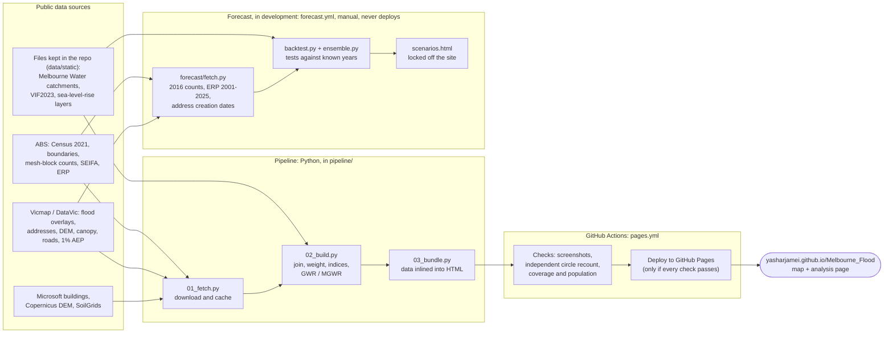

# How this project works

One page that explains the whole project: where the data comes from, what the code does with it,
how accurate each step is, and how to rebuild everything yourself.

Details live in other files, and this page links to them. Those other files are:

- [README](../README.md) for the method and the papers
- [ARCHITECTURE](ARCHITECTURE.md) for the code
- [PROJECT_LOG](PROJECT_LOG.md) for every decision and test, with dates

---

## 1. In one paragraph

The site is a map of Greater Melbourne's 31 councils that shows **who lives inside the planning-scheme flood overlays**.

- **The map.** You drag two circles, A and B, and compare the people inside them: age, need for assistance, no car, limited English, and residents in riverine and overland-flow overlays.
- **The data.** It comes only from public sources: ABS, Vicmap/DataVic, Melbourne Water and others. A Python pipeline downloads it, joins it down to mesh blocks and address points, computes the two papers' indices, and writes one self-contained HTML page.
- **Publishing.** GitHub Actions rebuilds, checks and publishes the page every month.
- **In development:** a second, *scenarios* page. It projects population to 2036 and adds sea-level-rise extents. It is built and tested but kept off the site until approved.

---

## 2. From data to website



**When it runs.**

| Workflow | Runs | What it does |
|---|---|---|
| `pages.yml` | On every push to `main` (except commits marked `[skip ci]`) and **monthly on the 2nd, 03:17 UTC** | Fetch, build, check, publish. A failed check leaves the live site on its last good version. |
| `forecast.yml` | By hand | Forecast inputs and back-tests. Never publishes. |
| `boundary.yml` | By hand | Exports the 31-council boundary as shapefiles, e.g. for DataShare orders |
| `demo.yml` | By hand | Records the demo GIF/MP4 from the live site |
| `probe.yml` | By hand | Checks what candidate data sources offer |

There is **no server and no database**. Each page is one HTML file with its data inside.

---

## 3. Every dataset

"Refresh" says how the site gets newer data.
- **Monthly** means the scheduled rebuild re-downloads it.
- **Fixed** means it changes only when a new edition is released and the code is updated.

### On the live site

| Dataset | From | Used for | Refresh |
|---|---|---|---|
| Census 2021 General Community Profile, SA1 (G01–G46 tables) | ABS | Age, sex, need for assistance, income, language, car, dwelling type | Fixed: next is the **2026 Census** (mid-2027) |
| ASGS 2021 boundaries: councils, SA1, mesh blocks, suburbs | ABS (ArcGIS REST) | The study area and every unit on the map | Monthly download; content fixed until ASGS 2026 |
| Mesh Block Counts 2021 | ABS | Placing residents within each SA1 | Fixed |
| Planning flood overlays: LSIO, FO, SBO | Vicmap Planning (WFS) | Who lives in a flood overlay | **Monthly**, live |
| Address points | Vicmap Address (WFS) | Placing homes inside or outside overlays (one point per property or unit) | **Monthly**, live |
| 1% AEP flood extent, statewide modelled | DataVic | Second flood layer, for comparison | **Monthly** |
| 10 m DEM | Vicmap Elevation (image service) | Elevation indicator | **Monthly** |
| 30 m DEM | Copernicus GLO-30 | Fallback if the 10 m DEM is unavailable | Fixed |
| Soil sand % | SoilGrids 2.0 (ISRIC) | Lama & Sun indicator | Fixed |
| SEIFA 2021, SA1 | ABS | Disadvantage deciles | Fixed: next with the 2026 Census |
| Tree extent 2020 (20 cm) | Vicmap Vegetation | Tree canopy per SA1 | Fixed until a new capture |
| Road casement | Vicmap Property | Road-reserve share per SA1 | **Monthly** (WFS) |
| Building footprints | Microsoft Global ML | Roof coverage per SA1 | **Monthly**: the newest tiles are picked up |
| River basins and waterway/drain subcatchments | Melbourne Water (`data/static/`) | Basin presets, drainage chain per SA1 | Fixed (in the repo) |

### For the scenarios page (in development)

| Dataset | From | Used for | Refresh |
|---|---|---|---|
| Mesh Block Counts 2016 and the 2016→2021 correspondence | ABS | Placement back-test | Fixed |
| Estimated Resident Population by SA2, 2001–2025 | ABS Data API | History and actuals for the council→SA2 tests | Yearly |
| Address creation dates since 2006 | Vicmap Address (WFS) | Where new homes appear: the housing-unit model | Re-downloaded on each forecast run |
| Victoria in Future 2023: councils to 2036, regions to 2051 | DTP (`data/static/vif2023/`) | Council population totals for 2026–2036 | Fixed: next VIF edition |
| Coastal inundation: 2009 baseline and +20/+47/+82 cm (2040/2070/2100) | DEECA via DataShare (`data/static/coastal_inundation/`) | Sea-level-rise extents | Fixed (DataShare links expire, so the files are in the repo) |

**Still to arrive:** the storm-tide versions of the sea-level layers, and Urban Development Program sites (redevelopment and greenfield land).

---

## 4. Every method, and how accurate it is

The **measured result** column says what was tested and what came out. Where nothing could be measured, it says so.

### The live map

| Step | Method | Measured result |
|---|---|---|
| Residents in each small area | Census SA1 totals split to mesh blocks by ABS mesh-block counts | Matches the Census to **0.02%** (4,833,357 vs 4,833,389) |
| Who is in a flood overlay | Each home's address point tested against the overlay, not the share of land | Counting by land overstated exposure by **29%** across Greater Melbourne (239,650 → **185,536 residents**) and by 50% in the papers' two councils |
| What a circle counts | Mesh blocks whose centre lies inside the circle, measured at the circle's own latitude | On every build: **300 random circles** recounted independently, plus council filters, real mouse drags and clicks. Deliberately broken copies of the page were all caught. |
| Lama & Sun (2026) indices | Their AHP weights and indicators, with public substitutes for flood depth, DEM and soil | Same 474 SA1s. FRI range −0.168 to 0.272 (paper −0.148 to 0.228). MGWR beats GWR as in the paper (R² 0.451 vs 0.232; lower than the paper because the response is a substitute). |
| Lee, Sun & Wachowicz (2026) | Their indicators | Most indicators are on the map. Their spatially adaptive index itself is **not computed yet**. |

**Not tested:** the overlays against observed floods (no public flood depth), real iPhone Safari (emulation only), and roof coverage accuracy. See README, *What is not tested*.

### The forecast (in development)

All figures are from back-tests: predicting a past year from earlier data, then comparing with what happened.

| Step | Method | Measured result |
|---|---|---|
| Placing growth inside an SA2 (2016→2021) | Growth goes where addresses were created at least 12 months before Census night (model E) | Error **11.6% at SA1**, 17.3% at mesh block, 33.4% in mesh blocks with heavy growth. So **mesh blocks are never published**, and SA1s only with ranges. |
| Splitting council totals into SA2s | Five simple models compared, plus their average and a machine-learning model | The **housing-unit model wins every test**: **2.7–6.0%** over 4–5 years, **11.7%** over 10 years, **17.0%** over 14 years. Averaging models did worse here. |
| Where that error sits (14 years) | | Established SA2s with 15,000+ residents: median **4%**. SA2s under 5,000: **53%**. SA2s that grew 60%+: **34%**. So growth-area figures get wide ranges. |
| Council totals (VIF2023) | Official projections, checked against what happened by 2025 | **Within 0.6%** for the 31 councils; typical council error **1.3%**. VIF under-projected growth slightly (413,000 vs 448,054). |
| End to end, 2021→2025 | VIF council totals + housing-unit split, against actual SA2 population | **3.9%** error (best case with known addresses: 3.3%) |
| Sea-level rise | State bathtub model, generalised to 1:75,000 | No accuracy figure. The publisher says it is "NOT suitable for assessments of potential risks at property level", so results are reported for suburbs, SA2s or councils only. |

Full tables: PROJECT_LOG §25 (placement) and §29 (councils → SA2s, VIF check).

---

## 5. Rebuild everything on your laptop

These steps are for Windows PowerShell. The macOS/Linux differences are noted where they apply.

### Once: set up

```powershell
cd "D:\Yashar projects\Melbourne_Flood"
git pull                                    # bring your copy up to date with GitHub
python -m venv .venv                        # Python 3.11 or newer
.venv\Scripts\activate                      # macOS/Linux: source .venv/bin/activate
pip install -r requirements.txt
```

### The live map

```powershell
python pipeline/01_fetch.py      # downloads ~1 GB on the first run (30-70 min); cached in data/raw/
python pipeline/02_build.py      # ~20 min, mostly the GWR/MGWR models
python pipeline/03_bundle.py     # writes dist/index.html and dist/analysis/index.html
python -m http.server 8000 -d dist
```

Then open http://localhost:8000 in a browser.

To refetch one dataset, delete its file in `data/raw/`. To refetch everything, delete `data/raw/metro/`.

Optional: the same circle check CI runs.

```powershell
pip install playwright
python -m playwright install chromium
python .github/scripts/check_circles.py metro
```

### The forecast and scenarios page

Run these after the live-map steps above, because they reuse its downloads.

```powershell
python pipeline/forecast/fetch.py      # 2016 counts, ERP by SA2, address dates (~5-10 min)
python pipeline/forecast/backtest.py   # placement back-test  -> data/processed/forecast_backtest.json
python pipeline/forecast/ensemble.py   # council->SA2 tests and VIF check -> data/processed/forecast_ensemble.json
python pipeline/forecast/forecast.py   # the 2036 forecast and residents in flood areas -> data/processed/scenarios.json
python pipeline/forecast/preview.py    # -> preview/scenarios/index.html
```

Open `preview/scenarios/index.html` in a browser.

**Urban Development Program (your laptop only).** UDP 2025 is under a DEECA licence, so the raw files never go to GitHub:

```powershell
# put Order_KR7TGF.zip and Order_EQKZCF.zip, as delivered by DataShare, in data\private\udp\
python pipeline/forecast/udp_aggregate.py   # -> data/static/udp2025/udp2025_pieces.csv (per-SA2 totals only)
```

Committing that summary file is your decision under the licence. Once it is in the repository, the forecast in GitHub uses it automatically. It never goes into `dist/` unless the real forecast exists **and** `PUBLISH_SCENARIOS=1` is set.

### Faster: let GitHub do it

Actions → choose the workflow → *Run workflow*:
- *Build and deploy* publishes the site.
- *Forecast back-test* never publishes.
- *Export study-area boundary* gives the shapefiles.

Results appear as downloadable artifacts on the run page, kept for 30 days.

---

## 6. Where everything is kept

| What | Where | Lasts |
|---|---|---|
| Code, docs, static data files | GitHub, `main` branch | Permanent |
| Decisions and test results | `docs/PROJECT_LOG.md` | Permanent |
| Downloaded raw data | Your `data/raw/` (local), or the Actions cache (CI) | Local: until you delete it. CI: refreshed monthly, removed after ~7 days unused. |
| Run outputs (screenshots, back-test reports, boundary files) | Actions artifacts | 30 days |
| Your laptop copy | `D:\Yashar projects\Melbourne_Flood` | Updated only when you run `git pull` |

---

## 7. Further reading

- **What the map shows, the method in full, and the papers:** [README](../README.md)
- **How the code fits together, the data contract, and the things that look wrong but are deliberate:** [ARCHITECTURE](ARCHITECTURE.md)
- **Why each decision was made, in order:** [PROJECT_LOG](PROJECT_LOG.md)
- **What changed and when:** [CHANGELOG](../CHANGELOG.md)
- **How to make a change** (worktrees, checks, conventions): [CONTRIBUTING](../CONTRIBUTING.md)
